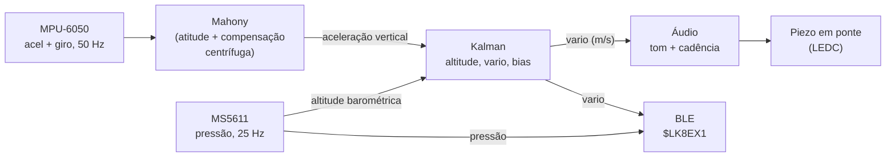
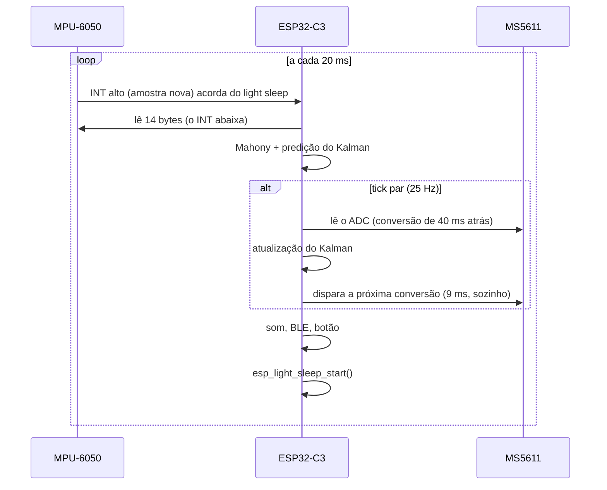

# Como funciona

Documentação técnica para quem quer entender, ajustar ou portar o firmware.

## Visão geral



Os dois sensores se complementam:

| Sensor | Ponto forte | Ponto fraco |
|---|---|---|
| Barômetro (MS5611) | Não deriva: a altitude média é correta | Ruidoso (~10–25 cm RMS). Filtrar demais atrasa a resposta |
| Acelerômetro (MPU-6050) | Responde na hora, sem atraso | Deriva: integrar o bias vira erro de velocidade crescente |

O filtro de Kalman usa o **acelerômetro para prever** e o **barômetro para corrigir**, e ainda estima o bias do acelerômetro. O resultado é um vario rápido e estável.

## Ciclo de execução e energia

O laço roda a **50 Hz**, sincronizado pelo pino INT do MPU-6050:



Decisões de baixo consumo:

| Decisão | Motivo |
|---|---|
| CPU a 80 MHz | É suficiente: o trabalho de cada ciclo leva ~1–1,5 ms |
| Light sleep acordado pelo INT do MPU | A CPU dorme ~93% do tempo. Há um timer de 50 ms de segurança |
| MS5611 não bloqueante | A conversão (OSR 4096, 9 ms) acontece com a CPU dormindo |
| Barômetro a 25 Hz | Metade do consumo do MS5611 a 50 Hz. Entre as leituras, o Kalman prevê com o acelerômetro |
| PWM do piezo no RC_FAST | O LEDC continua tocando durante o light sleep. Sem isso, a CPU ficaria acordada sempre que o vario apitasse |
| BLE desligado por padrão, com timeout | Com o rádio ativo não há light sleep (o controlador BLE do core Arduino não suporta o sleep manual) |
| Wi-Fi só no portal | O Wi-Fi nunca é iniciado no modo de voo |
| Deep sleep ao desligar | Acorda pelo botão (GPIO3), com consumo de dezenas de µA |

Estimativa de consumo (datasheets, **não medido**):

| Item | Médio |
|---|---|
| MPU-6050 (acel + giro) | ~3,9 mA |
| MS5611 a 25 Hz, OSR 4096 | ~0,33 mA |
| ESP32-C3 (janelas ativas + light sleep) | ~1,5–2,5 mA |
| Regulador, divisor, TP4056 | ~0,05 mA |
| **Total em silêncio** | **~6–7 mA** |
| Com BLE ativo | ~20–40 mA |
| Portal Wi-Fi | ~80–100 mA |

O MPU-6050 sozinho é mais da metade do total. Trocar por um IMU de baixo consumo (LSM6DSO, BMI270) é o próximo ganho grande.

## Barômetro (MS5611)

- Conversão de pressão (D1) e de temperatura (D2) em **OSR 4096**. Uma leitura de temperatura por segundo é suficiente, porque ela varia devagar.
- A compensação segue o datasheet, **incluindo a 2ª ordem** para temperaturas abaixo de 20 °C, e é calculada em **double**. O código inteiro do datasheet não tem resolução suficiente para um vario, como observa o [driver do har-in-air](https://github.com/har-in-air/ms5611).
- O CRC-4 da PROM (nota de aplicação AN520) é verificado no boot.
- Altitude pela fórmula ISA: `h = 44330,77 · (1 − (p / 101325)^0,190263)`. Para o vario, só a variação importa.

Teste no PC: o exemplo do datasheet (D1 = 9085466, D2 = 8569150) dá 20,08 °C e 100009,1 Pa. O esperado é 20,07 °C e 100009 Pa.

## Atitude e aceleração vertical (Mahony)

O acelerômetro mede a **força específica** no referencial da placa. Para obter a aceleração vertical é preciso saber onde está a vertical:

```
a_vert = (a_medida · û) − 1 g        (û = vertical estimada, no referencial da placa)
```

A vertical vem de um filtro **Mahony**: o giroscópio é integrado num quatérnio, e o acelerômetro corrige lentamente a deriva (`Kp = 0,5`, `Ki = 0,01`).

### O problema da curva

Numa curva coordenada, o piloto pendurado na asa **se alinha com a gravidade aparente**, e o acelerômetro mede `g / cos(inclinação)`. Se o Mahony confiar no acelerômetro durante a curva, a vertical estimada "segue" a gravidade aparente. A aceleração centrípeta então passa a aparecer como vertical, e o vario indica **subida falsa justamente ao centrar a térmica**.

O firmware usa duas defesas:

**1. Ganho adaptativo.** A correção pelo acelerômetro é multiplicada por

```
w = max(0, 1 − | |a| − 1 g | / 0,1 g)
```

Com |a| diferente de 1 g (curva, turbulência), o filtro passa a usar só o giroscópio.

**2. Compensação centrífuga.** Antes de usar o acelerômetro como referência de gravidade, o firmware desconta a aceleração centrípeta estimada:

```
a_c = ω × v
v   = V_ar · x̂_h
```

- `ω`: giroscópio
- `x̂_h`: eixo X da placa projetado no plano horizontal estimado
- `V_ar`: a **velocidade em térmica** (`airspeed`, padrão 9 m/s)

Num parapente a velocidade varia pouco em térmica, então um valor fixo funciona bem. Por isso a placa deve ser montada com o **X para frente**.

### Compensação centrífuga

Resultado na simulação: subida real de +2,0 m/s, asa a 10 m/s reais, curva mantida por 60 s.

| Velocidade configurada | Curva 30° (erro RMS) | Curva 45° (erro RMS) |
|---|---|---|
| 0 (sem compensação) | 0,52 m/s | 0,70 m/s |
| 8 m/s | 0,078 m/s | 0,142 m/s |
| **9 m/s (padrão)** | **0,044 m/s** | **0,070 m/s** |
| 11 m/s | 0,118 m/s | 0,213 m/s |

Superestimar a velocidade custa mais que subestimar, por isso o padrão fica um pouco abaixo do trim típico. Também faz sentido em voo: em térmica, o parapente voa perto do afundamento mínimo (~32–34 km/h).

## Filtro de Kalman

**Estado:** `x = [h, v, b]` (altitude em m, vario em m/s, bias do acelerômetro em m/s²).

**Entrada:** `u` = aceleração vertical do Mahony. A aceleração "verdadeira" é `u − b`.

**Predição** (a cada amostra do IMU, `dt` ≈ 20 ms):

```
h ← h + v·dt + ½(u − b)·dt²
v ← v + (u − b)·dt
b ← b

F = | 1  dt  −dt²/2 |        Q = G Gᵀ σ_a²  +  diag(0, 0, σ_b²·dt)
    | 0   1  −dt    |        G = [dt²/2, dt, 0]ᵀ
    | 0   0   1     |
```

**Correção** (a cada altitude barométrica, 25 Hz): `H = [1 0 0]`, `R = σ_z²`.

| Parâmetro | Padrão | Ajuste no portal |
|---|---|---|
| σ_a: ruído do acelerômetro, inclui erro de atitude | 0,35 m/s² | Confiança no acelerômetro (`kfAcc`) |
| σ_b: passeio aleatório do bias | 0,02 m/s²/√s | fixo |
| σ_z: ruído da altitude barométrica | 0,25 m | Ruído do barômetro (`kfBaro`) |

As contas são em float, com matrizes 3×3 explícitas. A covariância é simetrizada a cada correção, para robustez numérica.

## Áudio

```
f       = fBase + fPerMs · subida                 (máximo de 2200 Hz)
ciclo   = periodZero / (1 + 0,6 · subida)         (mínimo de 130 ms), 50% com som
afund.  = 450 + 40 · subida  Hz, contínuo         (mínimo de 200 Hz)
```

- Há histerese: o bipe liga em `liftOn` e desliga 0,05 m/s abaixo. O alarme liga em `sinkOn` e desliga 0,2 m/s acima.
- O período de cada bipe é fixado no início do ciclo, e a frequência acompanha a subida durante o bipe. Isso soa mais natural.
- **Piezo em ponte:** o canal 0 do LEDC vai para o GPIO0 e o canal 1, no mesmo timer, vai para o GPIO1 com a **saída invertida** na matriz de GPIO. O piezo vê 6,6 Vpp a partir de 3,3 V, cerca de 6 dB a mais, sem amplificador.

## Bluetooth: $LK8EX1

- **Serviço:** Nordic UART Service. Serviço `6E400001-B5A3-F393-E0A9-E50E24DCCA9E`, TX (notify) `6E400003-…`, RX `6E400002-…`. É o mesmo serviço usado pelo vario do [har-in-air](https://github.com/har-in-air/ESP32C3_BLUETOOTH_AUDIO_VARIO), validado com o XCTrack.
- **Sentença** (padrão LK8000):

```
$LK8EX1,<pressão Pa>,99999,<vario cm/s>,<temp °C>,<bateria V>,*<checksum>\r\n
$LK8EX1,95000,99999,123,22,3.92,*30
```

  - Altitude `99999` = não disponível, então o app calcula a altitude pela pressão.
  - Bateria `999` = não disponível.
  - O checksum é o XOR dos caracteres entre `$` e `*`.
- O MTU preferido é 64. Se o celular negociar um MTU menor, a sentença é quebrada em pedaços, o que funciona porque o NUS é um fluxo de bytes.
- **Energia:** potência de 0 dBm e anúncio a 200–500 ms. Depois de conectar, o firmware pede um intervalo de conexão de 50–100 ms.

## Simulação

`test/sim_flight.cpp` roda os mesmos filtros do firmware contra um voo sintético:

- **Verdade a 1 kHz:** asa com velocidade vertical prescrita, piloto como pêndulo de 7 m, curvas coordenadas com a centrípeta e as taxas de giro corretas no referencial da placa.
- **Sensores com erros de um MPU-6050 barato:**
  - offset de acelerômetro de 0,02–0,04 g por eixo
  - erro de escala de 1,5% (corrigido pela calibração de boot, como no firmware)
  - bias residual do giroscópio de 0,2–0,3 °/s
  - ruído
  - barômetro com 0,20 m RMS

| Cenário | Acel + baro | Só barômetro |
|---|---|---|
| Degrau −1 → +2 m/s, tempo até 50% / 90% | **0,26 s / 0,42 s** | 1,04 s / 1,84 s |
| Ruído em regime (RMS) | **0,026 m/s** | 0,10 m/s |
| Balanço lateral de 15°, erro RMS | **0,08 m/s** | 0,31 m/s |
| Curva de 30°, erro RMS (9 m/s) | **0,044 m/s** | — |

**Limites da simulação:** não tem turbulência real, vibração, erro de pressão estática (vento no sensor), variação de temperatura nem flexão da selete. Ela valida a lógica e os ganhos, mas não substitui o voo.

## Referências e créditos

- **har-in-air:** [ESP32C3_BLUETOOTH_AUDIO_VARIO](https://github.com/har-in-air/ESP32C3_BLUETOOTH_AUDIO_VARIO), [ESP32_IMU_BARO_GPS_VARIO](https://github.com/har-in-air/ESP32_IMU_BARO_GPS_VARIO) e [ms5611](https://github.com/har-in-air/ms5611). Fusão por Kalman em varios, $LK8EX1 por NUS e observações sobre a resolução do MS5611.
- **zmolnar/sensorio:** [lições sobre estimar a gravidade com IMU](https://github.com/zmolnar/sensorio).
- **TE Connectivity:** datasheet do MS5611-01BA03 e nota de aplicação AN520 (CRC da PROM).
- **R. Mahony et al.:** "Nonlinear Complementary Filters on the Special Orthogonal Group", IEEE TAC, 2008.
- **LK8000:** definição da sentença `$LK8EX1`.

O código deste repositório foi escrito do zero. Nenhum arquivo dos projetos acima foi copiado.
